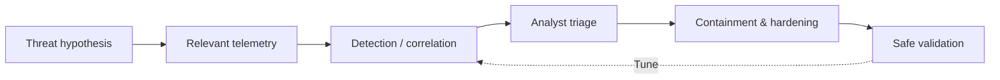

# 🛡️ Cyber Kill Chain — Defensive Detection & Response Lab

A cybersecurity portfolio lab that maps the **seven stages of the Cyber Kill Chain** to defender-visible signals, investigation questions, and mitigations. This project is a **training and detection-design reference**; examples are illustrative and do not represent validated detections or an operational SOC.

## 🔎 Defender workflow

## 🧩 Kill Chain to defensive coverage

| Kill Chain phase | Defender-visible clues | Defensive response | Related MITRE ATT&CK tactics (illustrative) |
| --- | --- | --- | --- |
| Reconnaissance | Unusual scanning patterns, repeated requests | Review network telemetry and exposed services | Reconnaissance (TA0043) |
| Weaponization | Often occurs outside monitored systems; limited direct visibility | Threat intelligence and artifact analysis | Resource Development (TA0042), where applicable |
| Delivery | Suspicious email attachments, web downloads | Email/web filtering and user reporting | Initial Access (TA0001) |
| Exploitation | Unusual application child processes, exploit-related alerts | Patch, isolate affected hosts, investigate process tree | Execution (TA0002) |
| Installation | New persistence entries or unexpected services | EDR investigation, baseline comparison | Persistence (TA0003) |
| Command & Control | Periodic outbound connections, unusual DNS behavior | Correlate proxy/DNS/network and endpoint data | Command and Control (TA0011) |
| Actions on Objectives | Unexpected data movement or file changes | DLP, access review, containment | Exfiltration (TA0010), Impact (TA0040) |

**Mapping note:** The Cyber Kill Chain and MITRE ATT&CK are different models; this table provides approximate associations, not a one-to-one equivalence.

## 🧪 Safe lab validation

Run the **real local loopback telemetry exercise** with `python3 scripts/local_telemetry_lab.py`. It writes observed events and a timestamped evidence report on your machine. See the [SOC investigation playbook](docs/soc-investigation-playbook.md) for steps and limitations.

## ✅ Observed Windows lab results\n\nThe project owner completed the local HTTP telemetry exercise on Windows and supplied a screenshot of the generated report showing **5 expected requests, 5 observed server events, 5 HTTP 200 responses, and PASS**. This validates local request logging only, not SIEM/EDR detection. Read the [observed-results case study](docs/windows-local-telemetry-case-study.md).\n\n## 📌 Portfolio status

- **Documented:** Kill Chain stages, example defensive telemetry, investigation workflow, and response ideas.
- **Not yet demonstrated:** SIEM/EDR ingestion, operational alerts, detection accuracy, and incident-response outcomes. Local loopback request logging has been demonstrated.

This repository deliberately focuses on **defensive understanding** rather than executable payloads, credential theft, persistence, or data exfiltration. Never test third-party systems without explicit authorization.
