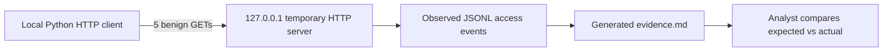

# SOC Investigation Playbook — Real, Reproducible Local Evidence

## What is real here?

This repository includes an **executable loopback telemetry exercise**. Running it starts a temporary HTTP service on your own machine, sends benign requests to it, captures **actual server-observed events**, and writes a timestamped Markdown evidence report. The evidence is real for **that local run**, but it is **not** proof of malware, command-and-control, an EDR alert, or a functioning SIEM.

## Run the exercise

Requirements: Python 3.9+; no third-party packages or cloud account.

```bash
python3 scripts/local_telemetry_lab.py --count 5 --interval 0.25
```

On Windows, use `py -3` in place of `python3` if needed.

Open **`lab-output/evidence.md`** to see the *actual UTC run time*, number of requests expected and observed, response status, and PASS/REVIEW outcome. Raw events are in **`lab-output/events.jsonl`**. Both are ignored by Git by default so evidence from one machine isn't mistaken for universal results.

### Architecture



## Analyst workflow

1. Check that `lab-output/events.jsonl` contains one JSON record per observed request.
2. Compare the expected count against the observed count in `lab-output/evidence.md`.
3. Inspect the UTC timestamps and status codes; note that a regular interval **does not imply malicious activity**.
4. Record the environment, Python version, and any unexpected behavior in your case study.
5. For a future SIEM exercise, explicitly configure log forwarding and independently validate ingestion and alerting before claiming those capabilities.

## Limitations and privacy

The service binds only to `127.0.0.1` on a temporary port and stops automatically. It does not contact third-party systems. The output proves the local script recorded requests during execution; it does not establish external network telemetry, persistence, intrusion, or MITRE ATT&CK technique detection. Review logs before sharing.
